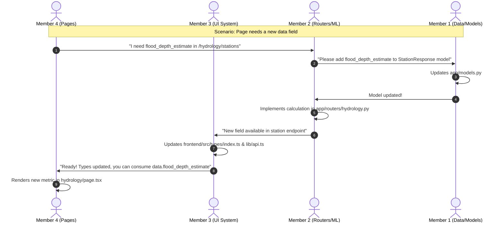

# 🗂️ FloodPulse AI — Codebase & Folder Ownership Guide

> **Purpose:** Clear directory boundaries for all 4 team members to prevent Git merge conflicts and streamline parallel development.

---

## 1. Quick Ownership Summary Table

| Member | Engineering Role | 📁 Primary Folders Owned | Secondary / Shared Files |
| :--- | :--- | :--- | :--- |
| **Member 1** 🟦 | **Backend Core & Data Lead** | `backend/app/connectors/`<br>`backend/app/database.py`<br>`backend/app/config.py`<br>`backend/app/models.py` | `backend/requirements.txt`<br>`backend/.env.example`<br>`backend/app/main.py` *(shared)* |
| **Member 2** 🟩 | **Backend Services & ML Lead** | `backend/app/routers/`<br>`backend/app/services/`<br>`backend/app/ml/`<br>`backend/app/data/` | `backend/app/main.py` *(shared)*<br>`backend/.env.example` |
| **Member 3** 🟨 | **Frontend Core & UI System** | `frontend/src/components/layout/`<br>`frontend/src/components/common/`<br>`frontend/src/lib/`<br>`frontend/src/hooks/`<br>`frontend/src/types/` | `frontend/package.json`<br>`frontend/tailwind.config.ts`<br>`frontend/tsconfig.json` |
| **Member 4** 🟪 | **Frontend Pages & Visuals** | `frontend/src/app/`<br>`frontend/src/components/maps/`<br>`frontend/src/components/charts/`<br>`frontend/src/messages/` | `frontend/public/geojson/`<br>`frontend/public/images/` |

---

## 2. Visual Project Directory Tree

```text
floodpulse-ai/
│
├── backend/
│   ├── requirements.txt                    👉 🟦 [Member 1] Python dependencies
│   ├── .env.example                        👉 🟦🟩 [Member 1 & 2] Backend env variables
│   │
│   └── app/
│       ├── config.py                       👉 🟦 [Member 1] API URLs, bounding boxes, station coords
│       ├── database.py                     👉 🟦 [Member 1] SQLite tables, aiosqlite connection
│       ├── models.py                       👉 🟦 [Member 1] Pydantic request/response schemas
│       ├── main.py                         👉 🟦🟩 [Member 1 & 2] App lifecycle & router mounting
│       │
│       ├── connectors/                     👉 🟦 [MEMBER 1 PRIMARY]
│       │   ├── base.py                     • Retry logic, rate limits, HTTP engine
│       │   ├── open_meteo.py               • Weather, GloFAS river discharge, accumulations
│       │   ├── copernicus.py               • Sentinel-1 SAR STAC search
│       │   ├── jrc.py                      • Global Surface Water tile URLs
│       │   ├── odc.py                      • Open Development Cambodia CKAN client
│       │   ├── mrc.py                      • Mekong River Commission placeholder
│       │   └── firms.py                    • NASA FIRMS fire/thermal client
│       │
│       ├── routers/                        👉 🟩 [MEMBER 2 PRIMARY]
│       │   ├── dashboard.py                • /api/v1/dashboard/kpis & summary
│       │   ├── hydrology.py                • Stations telemetry, timeseries, comparison
│       │   ├── weather.py                  • Forecasts, historical, accumulations
│       │   ├── satellite.py                • STAC search & GeoTIFF upload
│       │   ├── risk.py                     • AI risk assessments & model thresholds
│       │   ├── community.py                • Province profiles & historical records
│       │   ├── alerts.py                   • Emergency dispatch & Telegram triggers
│       │   ├── data_sources.py             • Data health & pipeline latency probes
│       │   └── admin.py                    • Admin controls & audit logs
│       │
│       ├── services/                       👉 🟩 [MEMBER 2 PRIMARY]
│       │   ├── risk_engine.py              • 5-factor Tonle Sap risk algorithm
│       │   ├── alert_service.py            • Threshold verification & deduplication
│       │   ├── telegram.py                 • Telegram Bot API message dispatch
│       │   └── scheduler.py                • APScheduler background recurring jobs
│       │
│       ├── ml/                             👉 🟩 [MEMBER 2 PRIMARY]
│       │   ├── features.py                 • 11-feature engineering pipeline
│       │   ├── training.py                 • Logistic Regression & Random Forest train
│       │   └── evaluation.py               • Precision, Recall, ROC-AUC, Brier score
│       │
│       └── data/                           👉 🟩 [MEMBER 2 PRIMARY]
│           └── seed.py                     • Initial records & historical Cambodian floods
│
├── frontend/
│   ├── package.json                        👉 🟨 [Member 3] NPM dependencies & scripts
│   ├── tailwind.config.ts                  👉 🟨 [Member 3] Navy/Cyan theme & animation tokens
│   ├── tsconfig.json                       👉 🟨 [Member 3] TypeScript compiler config
│   │
│   ├── public/                             👉 🟪 [Member 4 & Shared]
│   │   └── geojson/                        • provinces.geojson, water-bodies.geojson
│   │
│   └── src/
│       ├── lib/                            👉 🟨 [MEMBER 3 PRIMARY]
│       │   ├── api.ts                      • Typed fetch client for all backend routes
│       │   └── constants.ts                • Map centers, JRC tile templates, risk colors
│       │
│       ├── hooks/                          👉 🟨 [MEMBER 3 PRIMARY]
│       │   └── useApi.ts                   • Custom React hook for data fetching
│       │
│       ├── types/                          👉 🟨 [MEMBER 3 PRIMARY]
│       │   └── index.ts                    • TypeScript interfaces for all entities
│       │
│       ├── components/
│       │   ├── layout/                     👉 🟨 [MEMBER 3 PRIMARY]
│       │   │   ├── DashboardLayout.tsx     • Outer page shell with header & sidebar
│       │   │   ├── Navbar.tsx              • Top nav, theme switch, language switch
│       │   │   ├── Sidebar.tsx             • Nav links, collapsible drawer, NCDM hotline
│       │   │   └── Footer.tsx              • Attribution & scientific disclaimers
│       │   │
│       │   ├── common/                     👉 🟨 [MEMBER 3 PRIMARY]
│       │   │   ├── KPICard.tsx             • Metric cards with trend indicators
│       │   │   ├── RiskBadge.tsx           • Color-coded severity tags
│       │   │   ├── StatusBadge.tsx         • System operational status dot
│       │   │   ├── DataFreshness.tsx       • Relative timestamp badge
│       │   │   └── LoadingSpinner.tsx      • Glowing water pulse spinner
│       │   │
│       │   ├── maps/                       👉 🟪 [MEMBER 4 PRIMARY]
│       │   │   └── TonleSapMap.tsx         • Dynamic Leaflet map with JRC overlay tiles
│       │   │
│       │   └── charts/                     👉 🟪 [MEMBER 4 PRIMARY]
│       │       ├── TimeSeriesChart.tsx     • Discharge curve with p25/p75 bands
│       │       ├── RainfallChart.tsx       • 48-hour hourly rainfall bar chart
│       │       └── RiskGauge.tsx           • Semi-circular AI risk probability gauge
│       │
│       ├── app/                            👉 🟪 [MEMBER 4 PRIMARY]
│       │   ├── page.tsx                    • Public Landing Page
│       │   ├── dashboard/page.tsx          • Main Monitoring Dashboard
│       │   ├── hydrology/page.tsx          • Hydrological Monitoring & Station Compare
│       │   ├── weather/page.tsx            • Weather & Rainfall Intelligence
│       │   ├── satellite/page.tsx          • Satellite Water Extent & STAC Search
│       │   ├── risk/page.tsx               • AI Flood Risk Intelligence & Factor Breakdown
│       │   ├── community/page.tsx          • Community Profiles & Historical Timeline
│       │   ├── alerts/page.tsx             • Early Warning Center & Telegram Dispatch
│       │   ├── data-sources/page.tsx       • Open Data Intelligence & Pipeline Health
│       │   └── admin/page.tsx              • Administrative Command & Risk Sliders
│       │
│       └── messages/                       👉 🟪 [MEMBER 4 PRIMARY]
│           ├── en.json                     • English localization strings
│           └── km.json                     • Khmer (ភាសាខ្មែរ) translations
│
└── docs/                                   👉 [SHARED ACROSS ALL MEMBERS]
    ├── setup.md                            • Local running instructions
    ├── TEAM_COLLABORATION_GUIDE.md         • Team workflow & role matrix
    └── FOLDER_OWNERSHIP_GUIDE.md           • This folder mapping document
```

---

## 3. Detailed Role-by-Folder Guide

### 🟦 Member 1: Data Engineer & Backend Infrastructure Lead
* **Folders & Files You Modify:**
  * `backend/app/connectors/*` — All external data ingestion logic.
  * `backend/app/database.py` — Database schema creation, queries, table indices.
  * `backend/app/config.py` — Environment variable mappings, API endpoints, station metadata.
  * `backend/app/models.py` — Pydantic data schemas (API contracts).
  * `backend/requirements.txt` — Python package dependencies.
* **Do NOT Modify Without Coordination:**
  * Do not touch `backend/app/routers/` or `backend/app/services/` (Owned by Member 2).

---

### 🟩 Member 2: AI/ML Engineer & Backend Services Lead
* **Folders & Files You Modify:**
  * `backend/app/routers/*` — All 10 FastAPI route files under `/api/v1`.
  * `backend/app/services/*` — Risk engine algorithm, alert service, Telegram integration, APScheduler.
  * `backend/app/ml/*` — Feature extraction, training scripts, model evaluation.
  * `backend/app/data/seed.py` — Historical disaster data, initial database seeding.
* **Do NOT Modify Without Coordination:**
  * Do not change `backend/app/models.py` or `backend/app/connectors/*` without notifying Member 1.

---

### 🟨 Member 3: Frontend Systems Architect & UI Lead
* **Folders & Files You Modify:**
  * `frontend/src/components/layout/*` — Shell components (`DashboardLayout`, `Navbar`, `Sidebar`, `Footer`).
  * `frontend/src/components/common/*` — Reusable atoms (`KPICard`, `RiskBadge`, `StatusBadge`, `DataFreshness`).
  * `frontend/src/lib/*` — Typed `api.ts` client, constants, base URLs.
  * `frontend/src/hooks/*` — Custom React hooks (`useApi.ts`).
  * `frontend/src/types/*` — TypeScript interface definitions.
  * `frontend/tailwind.config.ts` & `frontend/src/app/globals.css` — Colors, fonts, animations.
* **Do NOT Modify Without Coordination:**
  * Do not edit individual page route files in `frontend/src/app/*/page.tsx` (Owned by Member 4).

---

### 🟪 Member 4: Geospatial & Product Experience Lead
* **Folders & Files You Modify:**
  * `frontend/src/app/*` — All 10 page routes (`page.tsx`, `dashboard/`, `hydrology/`, `weather/`, `satellite/`, `risk/`, `community/`, `alerts/`, `data-sources/`, `admin/`).
  * `frontend/src/components/maps/*` — Leaflet `TonleSapMap.tsx` and map layer controls.
  * `frontend/src/components/charts/*` — Recharts wrappers (`TimeSeriesChart`, `RainfallChart`, `RiskGauge`).
  * `frontend/src/messages/*` — English (`en.json`) and Khmer (`km.json`) language dictionaries.
  * `frontend/public/geojson/*` — Province boundaries and water body GeoJSON files.
* **Do NOT Modify Without Coordination:**
  * Do not rewrite shell components in `frontend/src/components/layout/` or design system configurations (Owned by Member 3).

---

## 4. Cross-Boundary Communication Protocol

To ensure seamless coordination without breaking each other's code:



1. **Rule 1 (Schema Changes):** If Member 4 needs a new field, they request it through Member 2 & 1. No frontend engineer edits backend models directly.
2. **Rule 2 (UI Component Additions):** If Member 4 needs a new reusable UI element (e.g. a specialized dropdown or modal), they ask Member 3 to add it to `components/common/` to preserve design consistency.
3. **Rule 3 (Branch Isolation):** Every member works exclusively on their designated feature branch (`feat/m1-...`, `feat/m2-...`, `feat/m3-...`, `feat/m4-...`) and merges into `develop` only via Pull Request.
