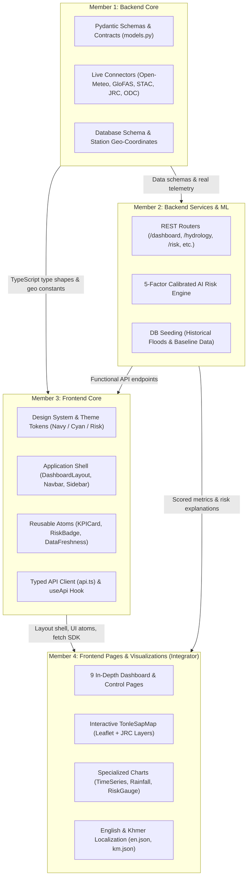
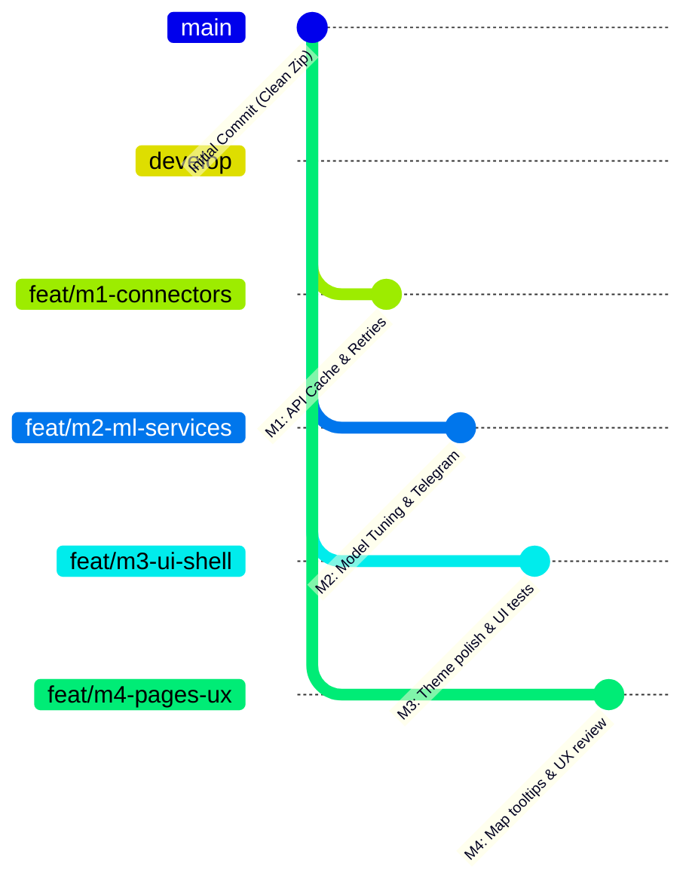

# 🌊 FloodPulse AI — Team Role Matrix & Git Collaboration Guide

> **Project:** FloodPulse AI — Competition-Ready Tonle Sap Flood Monitoring Platform  
> **Repository Architecture:** Monorepo (`backend/` + `frontend/` + `docs/`)

---

## 1. Retrospective: How Members 1, 2, and 3 Enabled Member 4

In the development of FloodPulse AI, **Member 4 (Frontend Pages & Interactive Visualizations Builder)** was the final integrator. The platform’s 10 analytical pages, interactive Leaflet mapping, and real-time hydrological charts could only be built smoothly because **Members 1 to 3** established foundational layers that eliminated blockers.



### The Collaboration Breakdown

| Contributor | Core Responsibility | Direct Enablement for Member 4 |
| :--- | :--- | :--- |
| **Member 1**<br>*(Backend Core)* | Data Contracts, Database Engine & Connectors | • Standardized Pydantic schemas so Member 4 knew the exact JSON structure.<br>• Connected real environmental APIs (Open-Meteo, GloFAS, Copernicus, JRC) so charts display authentic physical telemetry.<br>• Supplied calibrated station coordinates and flood warning thresholds. |
| **Member 2**<br>*(Backend Services & ML)* | REST Routes, AI Risk Engine & Data Seeding | • Exposed the 26 `/api/v1` routes consumed by Member 4's pages.<br>• Implemented the 5-factor risk engine and bilingual risk narratives for the risk gauge and factor breakdown charts.<br>• Seeded historical flood disaster records (2000, 2011, 2013, 2020) so the Community and Alert views were fully populated on first render. |
| **Member 3**<br>*(Frontend Core)* | UI Shell, Design Tokens & API Client SDK | • Created `<DashboardLayout>`, `<Navbar>`, and `<Sidebar>`, eliminating repetitive shell code across all 9 pages.<br>• Built reusable visual atoms (`KPICard`, `RiskBadge`, `StatusBadge`, `DataFreshness`).<br>• Provided the typed `api.ts` client and `useApi` React hook, allowing Member 4 to load live data with a single line of code. |
| **Member 4**<br>*(The Integrator)* | 9 Interactive Pages, Map & Chart Components | • Integrated Member 1's JRC tile URLs with Member 3's styling in `TonleSapMap.tsx`.<br>• Constructed Recharts visualizers (`TimeSeriesChart`, `RainfallChart`, `RiskGauge`).<br>• Delivered all 9 functional dashboard pages and verified full bilingual English/Khmer translations. |

---

## 2. Git Repository Setup & Team Workflow

### 2.1 Repository Structure
```text
floodpulse-ai/
├── .env.example              # Shared environment variables template
├── docker-compose.yml        # Multi-container local orchestration
├── README.md                 # Project introduction and quick-start
├── docs/                     # Architecture, setup, and team documentation
├── backend/                  # Python FastAPI service (Members 1 & 2)
│   ├── app/
│   │   ├── config.py
│   │   ├── database.py
│   │   ├── models.py
│   │   ├── connectors/       # Data ingestion pipelines (Member 1)
│   │   ├── routers/          # API route definitions (Member 2)
│   │   ├── services/         # Business & risk logic (Member 2)
│   │   ├── ml/               # Machine learning pipelines (Member 2)
│   │   └── data/seed.py      # Database seeding scripts
│   └── requirements.txt
└── frontend/                 # Next.js 14 App Router service (Members 3 & 4)
    ├── src/
    │   ├── app/              # Page routes (Member 4)
    │   ├── components/
    │   │   ├── layout/       # Shell components (Member 3)
    │   │   ├── common/       # UI atoms (Member 3)
    │   │   ├── maps/         # Leaflet map components (Member 4)
    │   │   └── charts/       # Recharts visualizations (Member 4)
    │   ├── lib/              # API client & constants (Member 3)
    │   ├── hooks/            # Custom React hooks (Member 3)
    │   ├── messages/         # Khmer & English translations (Member 4)
    │   └── types/            # TypeScript data definitions (Member 3)
    └── package.json
```

### 2.2 Branching Strategy

To avoid merge conflicts, each member must work within their designated Git branch:



* **Branch Naming Standard:**
  * Member 1: `feat/m1-connectors-data`
  * Member 2: `feat/m2-ml-risk-alerts`
  * Member 3: `feat/m3-ui-shell-theme`
  * Member 4: `feat/m4-pages-visuals-khmer`
* **Rule:** Never push directly to `main` or `develop`. Always submit a Pull Request with at least one peer review.

---

## 3. Concrete Action Plan: What Each Member Should Do Now

### 👤 Member 1: Data Engineer & Backend Core Lead
**Primary Focus:** `backend/app/connectors/`, `backend/app/config.py`, `backend/app/database.py`, `backend/app/models.py`

#### Immediate Tasks:
1. **Configure Live Data Keys:**
   * Test Copernicus STAC search with broader date ranges.
   * If available, add optional API keys to `.env` (`FIRMS_API_KEY`, `MRC_API_TOKEN`).
2. **Implement Response Caching:**
   * In `backend/app/connectors/open_meteo.py`, add local SQLite caching (e.g., 15-minute TTL) to prevent hitting Open-Meteo rate limits during live demonstrations.
3. **Database Maintenance & Migrations:**
   * Verify SQLite WAL mode (`PRAGMA journal_mode=WAL`) under concurrent reads.
   * Ensure foreign keys and indices in `app/database.py` are optimized for station telemetry queries.
4. **Validation Tests:**
   * Write unit tests under `backend/tests/test_connectors.py` verifying external API fallbacks when networks are offline.

---

### 👤 Member 2: AI/ML Engineer & Backend Services Lead
**Primary Focus:** `backend/app/routers/`, `backend/app/services/`, `backend/app/ml/`, `backend/app/data/seed.py`

#### Immediate Tasks:
1. **Calibrate the AI Risk Engine:**
   * In `backend/app/services/risk_engine.py`, fine-tune the 5-factor weightings for the Tonle Sap reverse-flow pulse (e.g., test dry vs. wet season threshold sensitivities).
2. **Train & Save the ML Baseline:**
   * Run the offline training pipeline:
     ```bash
     cd backend
     python -c "from app.ml.training import train_all_models; train_all_models()"
     ```
   * Confirm serialized model artifacts (`.joblib`) are generated in `backend/app/ml/models/`.
3. **Telegram Early Warning Integration:**
   * Create a Telegram bot via `@BotFather`, place `TELEGRAM_BOT_TOKEN` and `TELEGRAM_CHAT_ID` in `backend/.env`, and test `/api/v1/alerts/test-telegram`.
4. **API Performance Verification:**
   * Verify that `/api/v1/dashboard/kpis` responds in `< 150ms`.

---

### 👤 Member 3: Frontend Systems Architect & UI Lead
**Primary Focus:** `frontend/src/components/layout/`, `frontend/src/components/common/`, `frontend/src/lib/`, `frontend/src/hooks/`, `tailwind.config.ts`

#### Immediate Tasks:
1. **Theme & Responsiveness Audit:**
   * Test responsive breakpoints on mobile devices (iPhone/Android screens) and tablets.
   * Ensure dark/light mode toggle transitions smoothly across all components.
2. **State Management & Data Hook Resilience:**
   * In `frontend/src/hooks/useApi.ts`, add retry logic and exponential backoff for offline network handling.
3. **Emergency Banner Customization:**
   * In `frontend/src/components/layout/Sidebar.tsx`, verify the NCDM 1294 hotline link and local disaster committee emergency contacts.
4. **Performance & Bundle Optimization:**
   * Run `npm run build` inside `frontend/` to ensure zero compilation warnings and verify static assets are optimized.

---

### 👤 Member 4: Geospatial & Product Experience Lead
**Primary Focus:** `frontend/src/app/`, `frontend/src/components/maps/`, `frontend/src/components/charts/`, `frontend/src/messages/`

#### Immediate Tasks:
1. **Interactive Map Polish (`TonleSapMap.tsx`):**
   * Verify smooth layer switching between CartoDB Dark Matter, OpenStreetMap, and JRC Surface Water tile layers.
   * Ensure station click popups display formatted water levels and warning statuses clearly.
2. **Chart Data Bounds & Visual Polish:**
   * Check `TimeSeriesChart.tsx` to ensure GloFAS discharge forecasts display 95% and 25-75% uncertainty bands clearly in dark mode.
   * Verify `RiskGauge.tsx` animations on the `/risk` page.
3. **Khmer Localization Review (`km.json`):**
   * Audit Khmer Unicode typography (font rendering and line height) across all 10 pages.
   * Verify terms such as ព្រែកក្ដាម (Prek Kdam), កំពង់លួង (Kampong Luong), and ហានិភ័យ (Risk Level).
4. **End-to-End User Flow for Hackathon Demo:**
   * Rehearse the standard judge presentation narrative:
     `Landing Page` ➔ `Dashboard Overview` ➔ `Hydrology Deep-Dive` ➔ `AI Risk Breakdown` ➔ `Community Safe Zones` ➔ `Early Warning Broadcast`.

---

## 4. Local Setup Commands for Every Member

Each member can set up their local environment from the cloned repository using these commands:

### Backend (Members 1 & 2)
```bash
cd backend
python -m venv venv

# Windows PowerShell:
.\venv\Scripts\activate
# macOS / Linux:
source venv/bin/activate

pip install -r requirements.txt
cp .env.example .env

# Initialize and seed database:
python -m app.data.seed

# Start development server:
uvicorn app.main:app --reload --port 8000
```
*Health check URL:* `http://localhost:8000/health`  
*Interactive documentation:* `http://localhost:8000/docs`

### Frontend (Members 3 & 4)
```bash
cd frontend
npm install
cp .env.example .env.local

# Run Next.js App:
npm run dev
```
*Web application URL:* `http://localhost:3000`

---

## 5. Hackathon Competition Checklist

> [!IMPORTANT]
> Complete this pre-presentation checklist before demonstrating to judges:

- [ ] **Backend Health:** `http://localhost:8000/health` returns `status: "healthy"` and `database_connected: true`.
- [ ] **KPI Ingestion:** `http://localhost:8000/api/v1/dashboard/kpis` returns non-zero surface water area and active station counts.
- [ ] **Map Layer Rendering:** Tonle Sap map displays water bodies, station markers, and JRC surface water occurrence tiles.
- [ ] **Bilingual Toggle:** Switching between `English` and `ភាសាខ្មែរ` translates navigation, risk labels, and telemetry headers dynamically.
- [ ] **Risk Transparency:** `/risk` clearly displays the 5-factor weighting breakdown and explains that the model is calibrated for Tonle Sap seasonal dynamics.
- [ ] **Early Warning Disclaimer:** Notification modal prominently displays the official disclaimer noting that FloodPulse AI supplements, but does not replace, official NCDM/MOWRAM bulletins.
